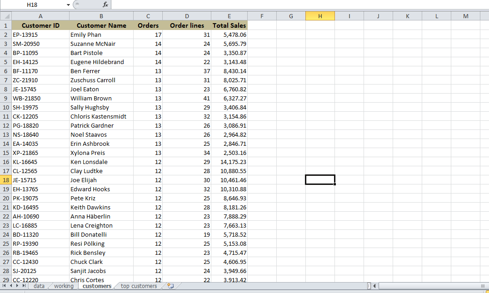
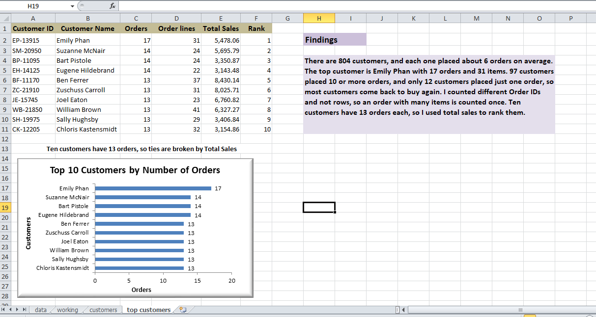

# Customer Order Count (Superstore Dataset)

## Overview
Counted orders per customer in the Sample Superstore Orders data (10,194 order lines) and
identified the top customers, using Excel.

## Workbook structure
- data: original Orders data
- working: copy of the data, sorted by Customer ID and Order ID, with a "New order" flag
- customers: one row per customer with orders, order lines and total sales
- top customers: top 10 customers and a bar chart

## Method
- Grouped by Customer ID (not by name, because there are 804 IDs but only 800 distinct names)
- Avoided duplicate order lines: counted different Order IDs per customer using a flag that
  is 1 only for the first row of each customer and order
- SUMIFS and COUNTIF for orders, order lines and total sales
- Sorted by orders, then by total sales

## Results
- 804 customers; average 6.36 orders per customer (median 6)
- Top customer: Emily Phan (EP-13915) with 17 orders and 31 order lines
- 97 customers placed 10 or more orders; only 12 customers placed a single order
- Ten customers have 13 orders, so the top 10 list uses total sales to break the tie

## Note
The total of orders per customer is 5,117, while there are 5,111 different Order IDs,
because 6 Order IDs appear under two different Customer IDs in the data.

## Tools Used
Microsoft Excel (Sort, SUMIFS, COUNTIF, Remove Duplicates, bar chart)

## Dataset
Sample Superstore Dataset

## Screenshots

